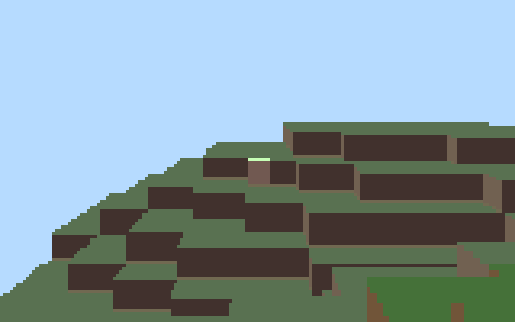
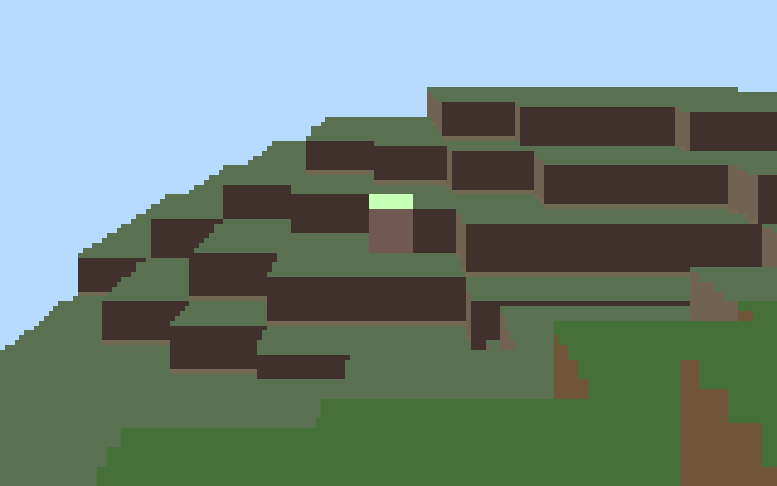
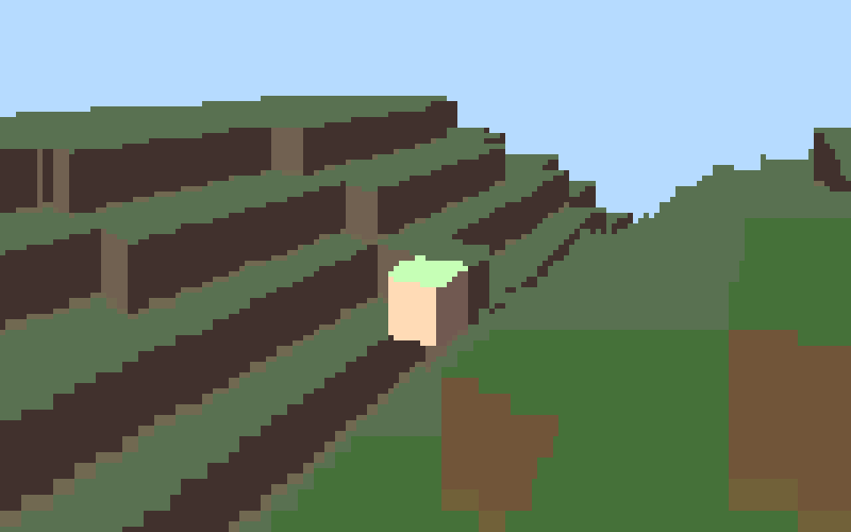

# PocketCraft 512

Wanted to see how much of a Minecraft-style world would fit into 512 bytes.

You can fly around, break blocks and build stuff. World generation, movement, block editing, collision checks and rendering all fit in one x86 boot sector.

**[Play in your browser](https://kierancschmitt.github.io/PocketCraft512/)** · [Watch the gameplay video](https://kierancschmitt.github.io/PocketCraft512/media/pocketcraft-gameplay.mp4) · [Read the assembly](PocketCraft512.S)

[](https://kierancschmitt.github.io/PocketCraft512/media/pocketcraft-gameplay.mp4)

## The 512-byte part

The [boot image](PocketCraft512.img) is exactly 512 bytes, boot signature included. The browser demo runs that same binary in a separate JavaScript x86 emulator for keyboard input and VGA output. The emulator and HTML are extra, outside the 512 bytes.

The 32 × 32 × 32 world gets generated at startup and lives in RAM. Only the generation code needs to fit in the file.

## Controls

| Key | Action |
| --- | --- |
| W / A / S / D | Move |
| Q / E | Turn left / right |
| ↑ / ↓ | Look up / down |
| R / F | Fly up / down |
| Backspace | Remove the highlighted block |
| Space | Place a block beside it |

In the browser, left click removes and right click places. Aim with the highlighted block in the center of the view.

## Screenshots

<p>
  
  
</p>

## Saving bytes

- block values double as palette colors
- movement and rendering share the rotation and voxel lookup code
- CPU flags from the lookup tell us air, solid or out of bounds
- the key table stores movement amounts or block materials alongside each key, so controls share code
- camera coords live on the stack; temporary values reuse memory from startup code

160 × 100 rays, up to 96 fixed steps each. Different shades for block faces, plus a palette shift for distant blocks.

## Run locally

Download [index.html](index.html) and open it in a browser. Binary and emulator are both in that file, nothing else to download.

## Build the boot image

With GNU binutils, run these from the project folder:

```sh
as --32 PocketCraft512.S -o PocketCraft512.o
ld -m elf_i386 -Ttext 0x7c00 -e _start PocketCraft512.o -o PocketCraft512.elf
objcopy -O binary -j .text PocketCraft512.elf PocketCraft512.img
wc -c PocketCraft512.img
```

Should come out to **512 bytes**: 485 for instructions, 24 for the key table, 1 padding byte and 2 for the boot signature.

## Limits

The world has boundaries and you fly freely. Fixed ray steps mean block edges can look rough at some angles. No gravity, inventory or saving yet; restarting resets the world.

The boot image needs 386-or-later x86, legacy BIOS and VGA. The browser emulator covers the instructions used here, not a full PC.

Created by Kieran Schmitt.

